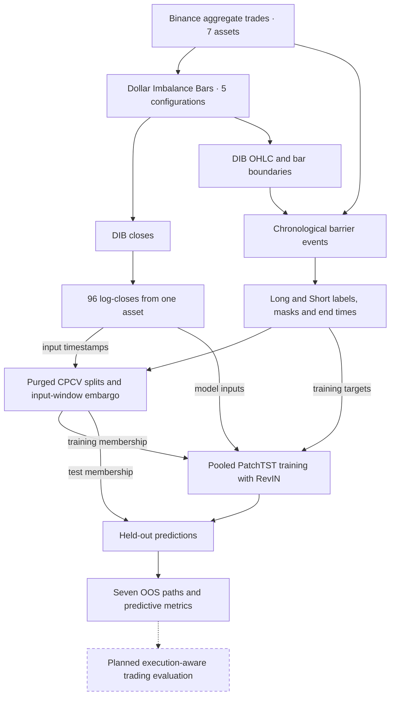
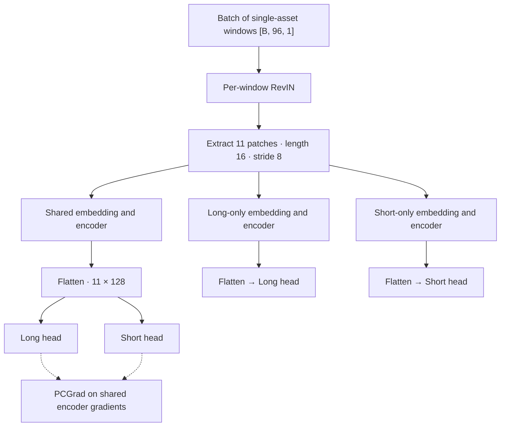

# Multi-Asset Quantitative Futures Research Framework

## Project Overview

Can one time-series model learn price patterns that help predict both Long and Short trading opportunities? This framework follows that question from exchange trade records to out-of-sample predictions. It samples prices when signed trading activity crosses a threshold. A 96-observation sequence can therefore span minutes during a burst of trading or much longer during a quiet period.

Across 420 fits on seven perpetual futures markets, sharing a PatchTST encoder helped both tasks most consistently under the finest fixed sampling configuration. On Fixed 5k, the shared model ranked positive outcomes more accurately on all seven reconstructed paths. The advantage varied with the sampling rule. [Experimental results](#experimental-design-and-results) · [Reproducing the work](#project-structure-and-reproducibility)

## What This Project Investigates

- **Sharing between tasks.** Does one encoder trained on both Long and Short outcomes, with PCGrad handling conflicting gradients, improve prediction over two independently trained encoders? The comparison uses the same eligible decisions for each task.
- **Sampling in information time.** How does changing the Dollar Imbalance Bar (DIB) configuration affect predictive performance and the advantage of sharing? Each configuration defines its own sequence of decisions and its own eight-bar outcome horizon.

## Key Achievements

| Stage | Completed work |
|---|---|
| Data engineering | Audited 6.49 billion aggregate-trade records. Generated 35 DIB datasets from seven assets and five configurations. Independent replay checked trade assignment, threshold crossings and unfinished tails. |
| Supervision | Audited 957,512 candidate label samples. Each decision carries separate Long and Short outcomes, validity masks and event intervals. |
| Validation | Built eight chronological groups, 28 combinatorial purged cross-validation (CPCV) splits and seven out-of-sample (OOS) paths per configuration. |
| Experiments | Completed 420 fits across three PatchTST conditions with deterministic sampling, checkpoint recovery, prediction export and independent checks of OOS sample keys and path membership. |

## Data Sources

The empirical study uses Binance USDⓈ-M perpetual futures on **ETHUSDT, SOLUSDT, AVAXUSDT, NEARUSDT, SUIUSDT, APTUSDT and LINKUSDT**. The original archives are available from Binance. The multi-billion-row dataset and generated experiment outputs are stored outside version control.

- **Historical archives.** The pipeline reads futures aggregate trades (`aggTrades`) with price, quantity, transaction time, aggregate ID, first and last underlying trade IDs, and the buyer-maker flag. [Binance Public Data](https://data.binance.vision/) · [Monthly USDⓈ-M aggregate trades](https://data.binance.vision/?prefix=data/futures/um/monthly/aggTrades/)
- **File definitions and integrity.** Binance documents the archive layout, column order and published checksums. [Binance Public Data repository](https://github.com/binance/binance-public-data)
- **Exchange semantics.** The official `GET /fapi/v1/aggTrades` reference defines how executions are aggregated and how to interpret the returned fields. [USDⓈ-M Futures aggregate trades API](https://developers.binance.com/en/docs/catalog/core-trading-derivatives-trading-usd-s-m-futures/api/rest-api/market-data#compressed-aggregate-trades-list)

## Overall Research Pipeline

**Figure 1. From trades to predictive evaluation.** The two branches meet at supervised training. Only the close-price branch supplies model features. Future executions determine the targets and the time intervals that CPCV must protect.



## Methodology

**When a bar closes.** Each aggregate trade contributes signed dollar value, `b × price × quantity`. A buyer acting as maker implies a seller-initiated trade (`b = −1`), otherwise `b = +1`. A bar closes at the first trade for which absolute cumulative imbalance **exceeds** `E_T × |E_x|`. The signed-dollar expectation `E_x` is an exponentially weighted mean over the most recent 10,000 trades, refreshed at completed bars. Fixed 5k, 10k, 20k and 28k set the expected trade count `E_T`; realized bar lengths vary. Adaptive 28k (`dynema28k` in code) also updates `E_T` from recent completed bar lengths, capped at 28,000. An unfinished tail stays open. [Bar construction](data_engine/bars.py) · [Independent replay](data_engine/dib_replay.py)

**What a positive label means.** At the decision close, volatility σ is the exponentially weighted root mean square of the last 64 one-bar log returns, with a 16-bar half-life. The first subsequent aggregate trade supplies the entry reference. In log-price units around entry, Long succeeds if +2σ is reached before −σ. Short succeeds if −2σ is reached before +σ. Chronological executions establish touch order, including within a bar. A stop gives that task a zero, as does reaching the eighth subsequent completed bar with neither barrier touched. Unresolved outcomes retain a null label and a false mask. A decision can therefore contribute to just one task. [Label rules](data_engine/labels.py) · [Output contract in code](data_engine/label_output.py)

**How overlap is handled.** Eight equal-duration UTC groups span the development period. Each split holds out two groups across all seven assets within one configuration. Training decisions are purged when either valid task event overlaps a protected test event, including across assets. The embargo excludes a training window if any of its 96 closes falls inside a test group or protected test-event interval. Within each training fold and task, a label's uniqueness reflects the reciprocal number of concurrent events in its own asset. Weights give each represented asset equal total mass before minibatch normalization. The runner records the realized contributions. [CPCV entry point](data_engine/cpcv.py)

## Model Architecture

One sample contains **96 consecutive log-closes from one asset**, with batch shape `[B, 96, 1]`. RevIN normalizes each sample using its own window statistics. A linear embedding and positional encoding map 11 overlapping patches into a Transformer with width 128, eight attention heads, three layers, feed-forward width 256 and dropout 0.1. Flattening the patch outputs gives 1,408 features per sample. Attention operates along that asset's sequence. Pooling across assets shares parameters while preserving each asset's own clock. [PatchTST models](models/PatchTST.py) · [Task-specific loss and PCGrad](train_step.py)

**Figure 2. Three model conditions.** Each condition trains its own patch embedding and three-layer encoder. In the shared model, both binary heads read the same representation. PCGrad projects conflicting task gradients on the shared parameters during training. Each head receives its own task gradient.



## Experimental Design and Results

**5 DIB configurations × 28 splits × 3 model conditions = 420 fits.** Each fit pools assets within a single configuration. The shared and independent models use matched initializations for corresponding parameters. Training uses FP32, master seed 2026, batches of 256 and 12 complete epochs. AdamW uses a 5% linear warm-up to 3 × 10⁻⁴ followed by cosine decay to 3 × 10⁻⁵. Evaluation uses the final checkpoint. Each OOS path routes decisions to their designated test fold and includes every group once.

The primary metric is **equal-asset macro Average Precision (AP)**. We use non-interpolated AP, weighting precision by each observed increase in recall. Each asset with positives contributes equally to the path's macro AP. The experiment also reports prevalence, pooled and per-asset scores, log loss and Brier score.

| Configuration | Long shared | Long independent | Long Δ | Short shared | Short independent | Short Δ |
|---|---:|---:|---:|---:|---:|---:|
| Fixed 5k | 0.28036 | 0.27432 | +0.00726 | 0.29650 | 0.29207 | +0.00375 |
| Fixed 10k | 0.30205 | 0.30029 | +0.00230 | 0.33290 | 0.33261 | −0.00011 |
| Fixed 20k | 0.29537 | 0.29573 | −0.00021 | 0.33026 | 0.32973 | +0.00015 |
| Fixed 28k | 0.31534 | 0.31342 | −0.00088 | 0.33347 | 0.33358 | −0.00011 |
| Adaptive 28k | 0.28733 | 0.28781 | −0.00022 | 0.32161 | 0.32262 | −0.00066 |

Model columns give the **median of seven path scores**. For **Δ**, subtract independent AP from shared AP *within each path*, then take the median of those seven differences. The two calculations can give different directions, as in Fixed 28k Long.

<details>
<summary>Read the results one task at a time (narrow screens)</summary>

Each row gives shared AP / independent AP, followed by the median paired difference.

**Long macro AP**

- **Fixed 5k** — 0.28036 / 0.27432 (Δ +0.00726)
- **Fixed 10k** — 0.30205 / 0.30029 (Δ +0.00230)
- **Fixed 20k** — 0.29537 / 0.29573 (Δ −0.00021)
- **Fixed 28k** — 0.31534 / 0.31342 (Δ −0.00088)
- **Adaptive 28k** — 0.28733 / 0.28781 (Δ −0.00022)

**Short macro AP**

- **Fixed 5k** — 0.29650 / 0.29207 (Δ +0.00375)
- **Fixed 10k** — 0.33290 / 0.33261 (Δ −0.00011)
- **Fixed 20k** — 0.33026 / 0.32973 (Δ +0.00015)
- **Fixed 28k** — 0.33347 / 0.33358 (Δ −0.00011)
- **Adaptive 28k** — 0.32161 / 0.32262 (Δ −0.00066)

</details>

**Fixed 5k.** Equal-asset positive prevalence was 24.172% for Long and 25.275% for Short. The shared model led on AP in **27 of 28 Long folds** and **28 of 28 Short folds**, with positive paired differences on all seven paths for both tasks. It also reduced median paired log loss and Brier score for both tasks. The smaller, mixed differences at coarser settings limit how far the Fixed 5k result generalizes.

## Project Structure and Reproducibility

```text
data_engine/     Archive ingestion, source audits, DIBs, labels and CPCV
layers/          RevIN, patch embedding, attention and encoder components
models/          Shared and independent PatchTST architectures
configs.py       Model configuration
train_step.py    Masked, weighted task losses and PCGrad update
training/        Fold data, weights, checkpoints, OOS export and matrix audits
docs/            DIB, label, model, CPCV and training contracts
data/            Local generated Parquets, manifests and validation receipts
runs/primary-v1/ Local checkpoints, predictions and primary experiment reports
```

Use separate Linux Python environments for data preparation and model training. The commands below run from the repository root in the indicated environment.

```bash
# Data pipeline · activate CPython 3.8.5 first
python -m pip install numpy==1.19.2 llvmlite==0.34.0 numba==0.51.2 \
    pyarrow==17.0.0 pandas==1.1.3 aiohttp==3.10.11

# Models · activate CPython 3.10.20 first
# The lock includes PyTorch 2.7.1+cu118, NumPy 2.2.6 and PyArrow 25.0.1
python -m pip install --extra-index-url https://download.pytorch.org/whl/cu118 -r requirements.lock
```

These pins describe the study environments. The checks below passed in the existing installations. A clean install has yet to be tested. [Model dependency ranges](requirements.txt) · [Model environment lock](requirements.lock)

**Start with the synthetic checks.** These exercise the pipeline and models without the historical archives.

```bash
# Data environment
python -m data_engine.test_dib
python -m unittest discover -s data_engine -p 'test_label*.py'
python -m unittest discover -s data_engine -p 'test_cpcv*.py'

# Model environment
python -m unittest -v test_patchtst test_train_step
python -m unittest discover -s training -p 'test*.py'
```

<details>
<summary>Historical pipeline entry points and required artifacts</summary>

These are stage-specific examples. Historical stages write local outputs and require their upstream artifacts.

```bash
# Inspect archive coverage for one month without downloading
python -m data_engine.ingest --dry-run --symbols ETHUSDT --start 2020-01 --end 2020-01

# Build and replay one stream from audited aggregate-trade Parquets
python -m data_engine.bars --symbols ETHUSDT --config fixed5k
python -m data_engine.dib_validate --symbols ETHUSDT --configs fixed5k

# With frozen source IDs, time checks and verification receipts in place
python -m data_engine.label_run verify --asset ETHUSDT
python -m data_engine.label_run generate --asset ETHUSDT --config fixed5k
python -m data_engine.label_run audit --asset ETHUSDT --config fixed5k

# With all 35 approved label datasets and receipts, write a fresh CPCV manifest
python -m data_engine.cpcv --holdout-start 2025-10-01T00:00:00Z --document-selection --output data/cpcv/reproduction-20251001
```

ZIP downloads go to `data/raw/aggTrades/`. Converted Parquets are staged for audit and promotion. The historical study used audited, promoted Parquets including date repairs and source-verified corrections. For label provenance, preserve the approved freeze and its DIB generation IDs. A fresh `bars_sensitivity --run-matrix` summary records `build` and `validation`, while `label_run freeze` expects the archived summary fields `status` and `input_rows`. Reproducing labels from new DIB generations requires reconciling those report formats. [Ingestion](data_engine/ingest.py) · [Source corrections](data_engine/corrections.py) · [Label provenance checks](data_engine/label_run.py)

In the model environment, `python -m training.qualify` runs the six qualification fits and exercises epoch-boundary recovery. `python -m training.replay` independently reproduces predictions from the six final checkpoints. The historical `python -m training.matrix` entry point requires the approved CPCV manifest, qualified artifacts, matching provenance and a compatible NVIDIA GPU. It reuses the six qualified fits. The local result files are `runs/primary-v1/REPORT.md`, `runs/primary-v1/path_medians.csv` and `runs/primary-v1/paths/report/`.

</details>

## Limitations and Future Work

The primary experiment uses one seed. CPCV paths reuse decisions and folds share training observations, so their win counts describe consistency within this study. Different DIB configurations also change class prevalence and the calendar time covered by each outcome. The within-configuration paired comparison is the clearest evidence about model sharing. It measures the combined effect of a shared encoder and PCGrad.

AP measures how well a model ranks opportunities. Net trading profitability remains an open question. Planned work includes chronological holdout evaluation, execution latency, bid–ask spreads, commissions, slippage, market impact and funding costs, followed by portfolio construction, risk management and paper trading.

## References and Methodological Background

- Marcos López de Prado, *Advances in Financial Machine Learning* (2018). The DIB sampling rule, triple-barrier labeling, sample uniqueness and CPCV build on this work. [Book](https://www.oreilly.com/library/view/advances-in-financial/9781119482086/)
- Yuqi Nie et al., *A Time Series Is Worth 64 Words: Long-term Forecasting with Transformers* (ICLR 2023). The framework adapts PatchTST's patching and channel-independent encoder for two binary classification tasks. [Paper](https://arxiv.org/abs/2211.14730) · [Authors' implementation](https://github.com/yuqinie98/PatchTST)
- Taesung Kim et al., *Reversible Instance Normalization for Accurate Time-Series Forecasting against Distribution Shift* (ICLR 2022). The classifiers use the input-normalization step of RevIN on each log-close window. [Paper](https://openreview.net/forum?id=cGDAkQo1C0p)
- Tianhe Yu et al., *Gradient Surgery for Multi-Task Learning* (NeurIPS 2020). PCGrad supplies the gradient projection used to train the shared representation. [Paper](https://proceedings.neurips.cc/paper/2020/hash/3fe78a8acf5fda99de95303940a2420c-Abstract.html)
